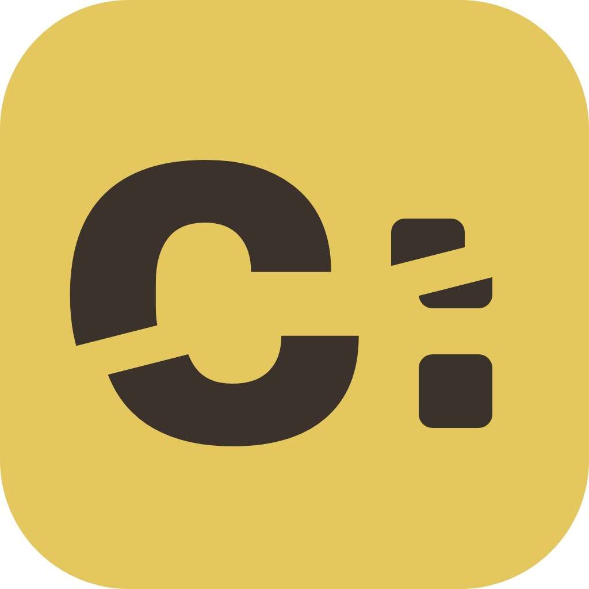
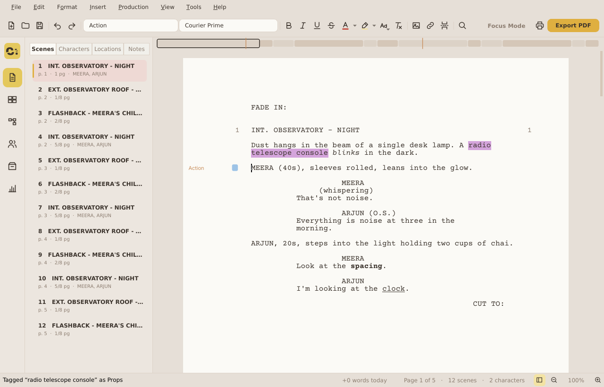
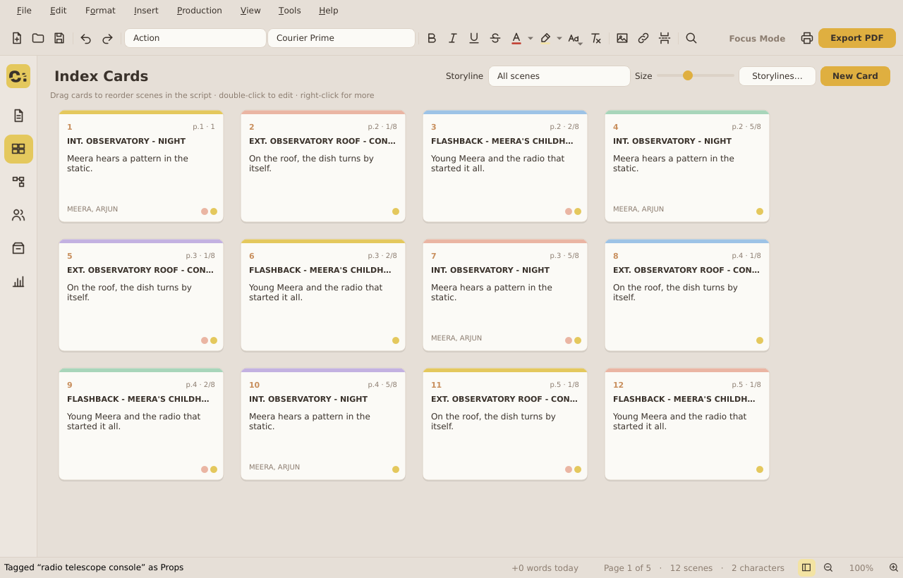
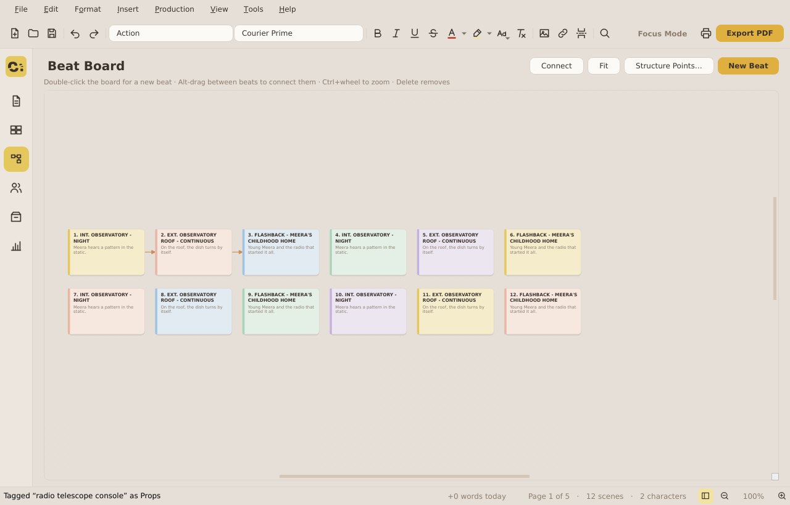
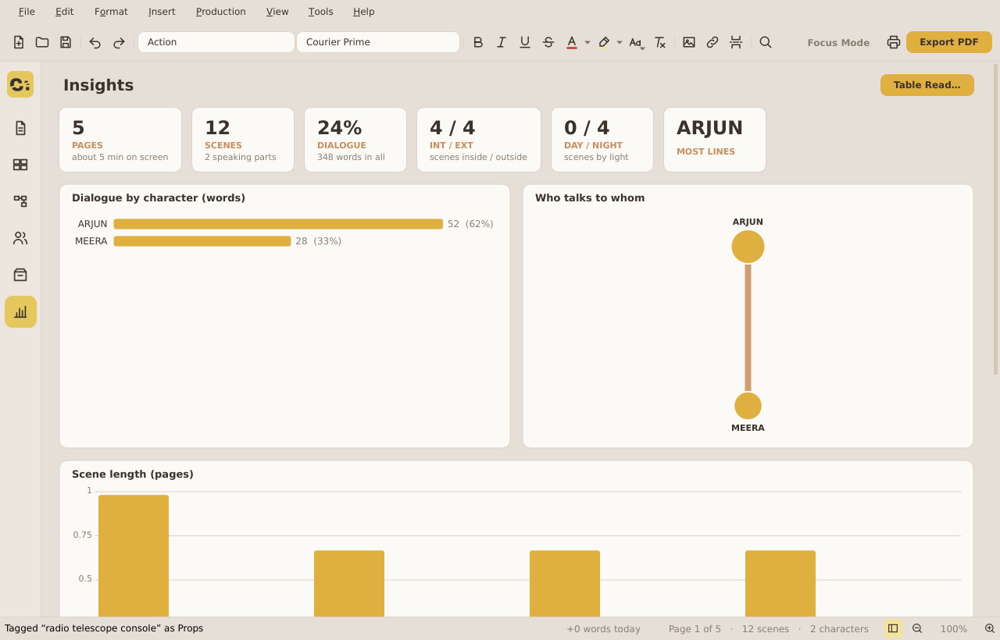
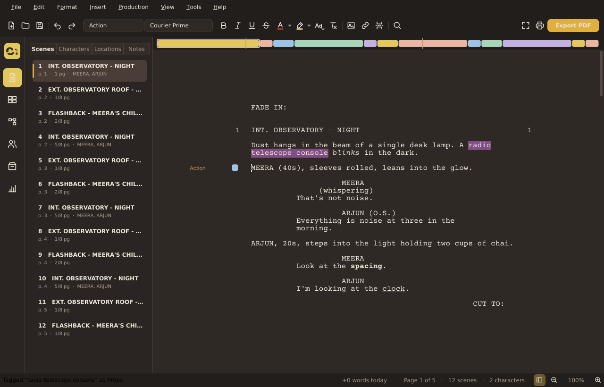

<p align="center">
  
</p>

<h1 align="center">Cut To:</h1>

<p align="center">
  A free, open-source screenwriting app for Windows, built from the page up for writers.<br>
  Industry-standard pages, SmartType, index cards, a beat board, revisions and production breakdowns,
  and it plays well with the files the industry already uses, <code>.fdx</code> included.
</p>

<p align="center">
  <a href="https://manojsriharsha-git.github.io/cut-to/"><b>Website</b></a> ·
  <a href="https://github.com/manojsriharsha-git/cut-to/releases/latest"><b>⬇ Download for Windows</b></a> ·
  <a href="docs/USER_GUIDE.md">User guide</a> ·
  <a href="docs/BUILDING.md">Build from source</a> ·
  <a href="CONTRIBUTING.md">Contribute</a>
</p>

<p align="center">
  <a href="https://github.com/manojsriharsha-git/cut-to/actions/workflows/ci.yml"></a>
  <a href="LICENSE"></a>
  
</p>



## Download and use

Go to the **[latest release](https://github.com/manojsriharsha-git/cut-to/releases/latest)** and pick one of the two files:

| | File | How |
|---|---|---|
| **Portable** (no install) | `CutTo-x.y.z-Windows-Portable.zip` | Right-click → **Extract All**, open the `Cut To` folder, double-click **Cut To.exe**. Runs from anywhere, even a USB stick. |
| **Installer** | `CutTo-Setup-x.y.z.exe` | Double-click it. Adds a Start-menu entry, a desktop shortcut and opens `.cut` / `.fountain` / `.fdx` files with Cut To:. |

Works on Windows 10 and 11 (64-bit). Nothing else to install.
If Windows says *"Windows protected your PC"*, click **More info → Run anyway**. The app isn't code-signed yet, which is why Windows asks.

> **Not the green "Code → Download ZIP" button.** That gives you the source code, which is for developers. To *use* Cut To:, take a file from the **Releases** page.

## What it does

| | |
|---|---|
| **Write** | Real US Letter pages in Courier Prime 12 pt. A natural Enter/Tab element flow. **SmartType** predicts scene headings, characters and transitions and learns from your scripts. Proper page rules: no headings stranded at the bottom of a page, and **(MORE)** / **NAME (CONT'D)** when a speech splits. |
| **Comfort** | Find & Replace, Go To, a command palette (Ctrl+Shift+P), spelling as you type, Day / Night / Midnight themes, Focus Mode, typewriter scrolling, a daily word goal, rename a character everywhere, smart paste, crash recovery and version history. |
| **Plan** | **Index cards**: drag a card to move the scene in your script. **Beat Board** with flow lines, storylines, structure points, a scene ribbon above the page, and character profiles with a "lens" that highlights a character's lines. |
| **Rewrite** | ScriptNotes on any paragraph. **Revision mode** with coloured asterisks in the industry's standard colour order (Blue, Pink, Yellow…) and a revision header in the PDF. Compare and restore any earlier version. |
| **Produce** | Locked scene numbers (12A, 12B), omitted scenes, breakdown tagging and sheets, shot lists, a stripboard, and TV, multi-camera and stage play templates. |
| **Analyse** | Dialogue by character, scene lengths, who appears in which scene, who talks to whom, estimated screen time, and **Table Read**, which reads the script aloud with a voice per character. |
| **Fonts** | 32 free, open-licence fonts built in (typewriter, document and title faces), plus any font you add. |
| **Files** | Open `.cut` `.fdx` `.fountain` `.docx` `.pdf` `.celtx` `.trelby` `.highland` `.fadein` `.txt`. Save `.cut` `.fdx` `.fountain`. Export PDF, Word, RTF and plain text. |

<table>
  <tr>
    <td></td>
    <td></td>
  </tr>
  <tr>
    <td align="center">Index cards</td>
    <td align="center">Beat Board</td>
  </tr>
  <tr>
    <td></td>
    <td></td>
  </tr>
  <tr>
    <td align="center">Insights</td>
    <td align="center">Night theme</td>
  </tr>
</table>

New to it? The **[user guide](docs/USER_GUIDE.md)** covers every feature and shortcut.

## File formats

- **`.cut`** is Cut To:'s own format, and the only one that keeps absolutely everything. It is plain JSON, so you can read it with any text editor or version it with git.
- **`.fdx`** opens and saves, so you can swap scripts with other software. Cut To:'s cards, beats and notes ride along in a section other apps ignore, so nothing is lost when you open the file in Cut To: again. Links are the only thing `.fdx` can't keep.
- **Fountain** keeps the text and the screenplay structure.

## Build from source

You need Python 3.12 or newer. Then:

```
git clone https://github.com/manojsriharsha-git/cut-to.git
cd cut-to
python -m venv .venv
.venv\Scripts\activate
pip install -r requirements.txt
python main.py            # run the app
python -m pytest          # run the 100 self-checks
build.bat                 # make Cut To.exe and the installer (Windows + Inno Setup 6)
```

[docs/BUILDING.md](docs/BUILDING.md) has the full steps (PyCharm too) and explains how releases are built automatically on GitHub.

## Contributing

Bug reports, ideas and pull requests are welcome.
- **Bugs and ideas:** [open an issue](https://github.com/manojsriharsha-git/cut-to/issues).
- **Code:** read [CONTRIBUTING.md](CONTRIBUTING.md) first.
- **Finding your way around:** [docs/ARCHITECTURE.md](docs/ARCHITECTURE.md) shows how the code is organised.

## Licence

Cut To: is free software under the **[GNU General Public License v3.0 or later](LICENSE)**. You may use, study, share and change it. If you share a changed version, it must stay open source under the same licence.

Cut To: is built with Qt for Python (LGPL), pyspellchecker, python-docx and pdfplumber (MIT). The fonts it bundles are under the SIL Open Font License or Apache 2.0, and each font's licence sits next to it in `resources/fonts/`. See [THIRD_PARTY_NOTICES.md](THIRD_PARTY_NOTICES.md).

*All trademarks belong to their respective owners. Cut To: is an independent project.*
