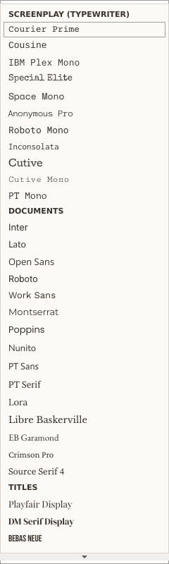

# Cut To: user guide

This guide covers everything Cut To: does, roughly in the order you'll meet it. For installing, see the [README](../README.md).

- [The screen](#the-screen)
- [Writing](#writing)
- [SmartType](#smarttype)
- [Pages, PDF and printing](#pages-pdf-and-printing)
- [Formatting, fonts and inserting](#formatting-fonts-and-inserting)
- [Finding and moving around](#finding-and-moving-around)
- [Writing comfort](#writing-comfort)
- [Planning: cards, beat board, characters](#planning-cards-beat-board-characters)
- [Rewrites: notes, revisions, versions](#rewrites-notes-revisions-versions)
- [Production](#production)
- [Insights and table read](#insights-and-table-read)
- [Files and formats](#files-and-formats)
- [Your data and safety nets](#your-data-and-safety-nets)
- [Keyboard shortcuts](#keyboard-shortcuts)

## The screen

- **The rail** down the left edge switches views: Script, Index Cards, Beat Board, Characters, Production and Insights. Ctrl+Alt+1 to 6 do the same.
- **The navigator** lists Scenes, Characters, Locations and Notes; click a row to jump there. Ctrl+\ hides it.
- **The scene ribbon** above the page shows every scene as a strip sized by its length and coloured by its card colour. Click a strip to jump to that scene.
- **The status bar**:
  - left: the element you're in and what Enter and Tab will do next;
  - right: today's word count, the page you're on, the number of scenes and characters, and zoom.

## Writing

Cut To: knows the screenplay elements and moves between them for you.

| You press | On | You get |
|---|---|---|
| **Enter** | Scene Heading | Action |
| | Action | Action |
| | Character | Dialogue |
| | Parenthetical | Dialogue |
| | Dialogue | Action |
| | Transition | Scene Heading |
| **Enter on an empty line** | | Action → Transition → Scene Heading (changes in place) |
| **Tab** | | Action → Character → Transition → Scene Heading; Dialogue ↔ Parenthetical |
| **Tab at the end of a filled line** | Action | a new Character below |
| | Dialogue | a new (Parenthetical) below |
| **Shift+Tab** | | cycles backwards |
| **Ctrl+1 … Ctrl+8** | | Scene Heading, Action, Character, Parenthetical, Dialogue, Transition, Shot, General |
| **Shift+Enter** | | a line break inside the same paragraph |
| **Ctrl+Enter** | | a page break |

Cut To: also reads what you type:
- `int.`, `ext.`, `est.` or `i/e` makes the line a Scene Heading.
- A name in CAPITALS on its own line becomes a Character when you press Enter.
- In action and dialogue, the first word of a paragraph or a new sentence gets its capital letter as soon as you type the space after it. Ctrl+Z takes it back; **Format → Capitalize Sentences Automatically** turns it off.
- Anything ending in `TO:` becomes a Transition.
- `(` at the start of dialogue makes a Parenthetical and closes the bracket for you.

## SmartType

Grey ghost text shows what Cut To: thinks comes next. **Enter** or **→** accepts it, **Esc** dismisses it, and **↑ ↓** pick from the list.

- **Scene headings:** it learns the intro, location and time of day of every heading. Typing `ext. ob` offers `EXT. OBSERVATORY ROOF - CONTINUOUS`. On an empty heading it guesses the next location from the order your scenes usually follow.
- **Characters:** in a conversation it offers the other speaker (A → B → A). When the same person speaks again after some action, it offers `NAME (CONT'D)`. Each character is offered once: `MANOJ (V.O.)` and `MANOJ` are the same person. Typing `(` offers V.O., O.S., O.C. and CONT'D.
- **Transitions:** it ranks them by how often you use them.

SmartType learns from every script you open or save. To clear what it has learned, choose **Production → Forget SmartType Memory**.

## Pages, PDF and printing

The page is a real US Letter page: Courier Prime 12 pt, 1-inch top and bottom margins, and industry-standard indents. What you see is what prints. The page rules are applied as you write:
- A scene heading or shot is never the last line on a page.
- A character name always has at least two lines of their speech under it.
- A speech that runs over a page keeps at least two lines on each page, never ends a page on a parenthetical, and gets **(MORE)** and **NAME (CONT'D)**.
- A paragraph of action that splits keeps at least two lines on each page.

Page numbers appear top right from page 2. Scene numbers appear in both margins once you choose **Production → Number Scenes**.

- **Export PDF:** **File → Export PDF** (Ctrl+Shift+E), or the honey button on the toolbar.
- **Print:** **File → Print** (Ctrl+P), or **Print Preview** first.
- **Title page:** **Production → Title Page…** fills it in, and it prints as page 1.

## Formatting, fonts and inserting

- **Text style:** bold, italic, underline and strikethrough (Ctrl+B / Ctrl+I / Ctrl+U / Ctrl+Shift+X), plus text colour, highlight and change case. **Clear Formatting** (Ctrl+Space) removes them.
- **Fonts:** the font box on the toolbar sets the font of the selected text. **Format → Script Font…** changes the whole script. Scripts are normally in Courier, and studios expect it, so Cut To: asks before using a non-typewriter font for a whole script.
- **Built-in fonts:** 32 free fonts in three groups:
  - **Screenplay:** Courier Prime, Cousine, IBM Plex Mono, Special Elite and more.
  - **Documents:** Inter, Lato, Lora, EB Garamond and more.
  - **Titles:** Playfair Display, Bebas Neue and more.

  The fonts already installed on your computer are listed after them.
- **More fonts:**
  1. Choose **Format → Get More Fonts…** to open Google Fonts, where every font is free.
  2. Download a font and unzip it.
  3. Choose **Format → Add Font File…** and pick its `.ttf` files.
- **Insert:**
  - **Image** (Ctrl+Shift+I) adds a picture on its own line.
  - **Link** (Ctrl+K) adds a hyperlink; Ctrl+click a link to open it.
  - **Page Break** (Ctrl+Enter) starts a new page.

## Finding and moving around

- **Find:** **Ctrl+F**. Every match is highlighted. F3 and Shift+F3 go to the next and previous match. You can match case, whole words, or search one element only (for example, only Character names).
- **Find and Replace:** **Ctrl+H**. **Replace All** is a single undo step.
- **Go To:** **Ctrl+G** jumps to a scene number or a page.
- **Command palette:** **Ctrl+Shift+P**. Type a few letters of any command or scene name, then press Enter.

## Writing comfort

- **Spelling:** a red wavy line marks unknown words. Right-click one for suggestions, **Add to Dictionary** or **Ignore All**. Character names and screenwriting words (INT, CONT'D, V.O.…) are never marked. F7 turns spelling on or off.
- **Themes:** **View → Theme → Day / Night / Midnight**. PDFs always print black on white.
- **Focus Mode:** click **Focus Mode** on the toolbar or press **Ctrl+Shift+F**. Everything but the page disappears, and the paragraphs around the one you're writing fade. To come back, click the **✕** in the top-right corner (it says *Exit Focus Mode* when you point at it), or press Esc.
- **Typewriter scrolling:** **Ctrl+Shift+T** keeps the line you're typing in the middle of the screen.
- **Writing goal:** click the word count in the status bar to set a daily goal. Only words you type count; pasting or opening a script doesn't. The goal dialog also shows your streak.
- **Rename Character:** **Production → Rename Character…** changes a name on every cue, keeping V.O. and CONT'D. Tick the option to change it in action and dialogue too. It is one undo step.
- **Copy and paste** keep element types between Cut To: scripts. Plain screenplay text pasted from elsewhere is sorted into headings, action, characters and dialogue.

## Planning: cards, beat board, characters

**Index Cards** (rail icon 2)
- Every scene is a card showing its number, heading, length and the characters who speak.
- Double-click a card to give it a synopsis, colour and storylines.
- **Drag a card to move that scene in the script.** Ctrl+Z moves it back.
- **New Card** adds a scene, and the Storyline filter shows one thread at a time.

**Beat Board** (rail icon 3) is a free canvas for story beats.
- **Add a beat:** double-click empty space.
- **Connect two beats:** Alt-drag from one beat to the other, or use **Connect**.
- **Zoom:** Ctrl+wheel. **Delete** removes the selected beat or line.
- **Turn a beat into a scene:** right-click it → **Add to Script as Scene**.
- **Beats From Scene Cards** lays your existing scenes out as beats.
- **Structure Points…** marks where the big turns should land, such as the inciting incident and midpoint. They show on the scene ribbon.

**Storylines:** **Tools → Storylines…** names the threads of your story, each with a colour. You tag scenes with them on their cards.

**Characters** (rail icon 4)
- Each character has a profile: description, age, want, need, flaw, arc, backstory, voice, cast and notes.
- It also shows their numbers: speeches, words, share of the dialogue, and the scenes they're in.
- **Highlight their lines in the script** colours that character's speeches on the page.

## Rewrites: notes, revisions, versions

- **ScriptNotes:** right-click a paragraph → **Add ScriptNote**, or press Ctrl+Shift+N. A coloured tab marks the paragraph in the left margin, and every note is listed in the navigator's **Notes** tab. Notes travel with their paragraph when you cut, paste or move scenes, and they never print.
- **Revisions:**
  1. Choose **Tools → Revisions → Revisions…** and pick the revision colour (Blue, Pink, Yellow, Green, Goldenrod… in the industry's standard order) and its date.
  2. Turn on **Revision Mode** (Ctrl+Shift+M).
  3. Every paragraph you change now gets an asterisk in the right margin. The PDF prints a header such as *Blue Rev. (10/27/2026)* on every page.
  4. When you start a fresh round, choose **Clear Revision Marks**.
- **Version History:** **File → Version History…**. Every save keeps a copy. Pick one to see what changed since then, line by line. **Restore This Version** brings it back, after saving the current script as a version first. **File → Save Version…** keeps a named milestone, such as "Studio draft".

## Production

- **Number Scenes**, then **Lock Scene Numbers:** existing numbers never change after that. A new scene after 12 becomes 12A, then 12B, and a scene before 1 becomes A1.
- **Omit Scene** keeps a numbered scene's slot and replaces it with *OMITTED*.
- **Breakdown:** select words in the script → right-click → **Tag as → Props / Wardrobe / Vehicles / …**. **Show Breakdown Tags** colours every tagged item where it appears in the scene.
- **The Production view** (rail icon 5) has:
  - **Breakdown:** every scene's tagged elements, and its cast (who speaks).
  - **Shot List:** shot, size, angle, movement, lens, description and notes.
  - **Stripboard:** scenes sorted for shooting by location and time of day.
  - **Exports:** breakdown sheets as PDF (one per scene), the breakdown as CSV, and the shot list as CSV.
- **Templates:** **Format → Page Template** switches between Screenplay, TV Drama, Multi-Camera Sitcom (action in CAPS, double-spaced dialogue) and Stage Play. **File → New From Template** starts a new script in one of them.

## Insights and table read

**Insights** (rail icon 6) shows:
- page count and estimated runtime (one page is about one minute);
- INT / EXT and DAY / NIGHT counts;
- dialogue share, and dialogue by character;
- the length of every scene;
- who speaks in which scene, and who talks to whom;
- a screen-time table.

**Table Read** (Tools → Table Read…) reads the script aloud from the cursor.
- Each character gets a voice, and a narrator reads action and headings.
- The paragraph being read is highlighted.
- You can change the speed, pause and stop.
- To add more voices to Windows: **Settings → Time & Language → Speech → Add voices**.

## Files and formats

| | Open | Save | Export | Keeps |
|---|---|---|---|---|
| **Cut To:** `.cut` | ✓ | ✓ | | everything |
| **FDX** `.fdx` | ✓ | ✓ | ✓ | everything except links |
| **Fountain** `.fountain` | ✓ | ✓ | ✓ | text and structure |
| **Word** `.docx` | ✓ | | ✓ | text, structure, styles |
| **PDF** | ✓ (screenplay PDFs) | | ✓ | |
| **RTF**, **plain text** | `.txt` | | ✓ | |
| **Celtx**, **Trelby**, **Highland**, **Fade In** | ✓ | | | text and structure |

When saving to a format that can't keep everything in your script, Cut To: warns you and offers to save a `.cut` file instead. Files from before the app was renamed, saved as `.screenplay`, still open.

## Your data and safety nets

Everything lives in `%APPDATA%\Cut To\Cut To\`:
- `smart_memory.json`: what SmartType has learned.
- `dictionary.txt`: words you added to the spelling dictionary.
- `fonts\`: fonts you added.
- `history\`: every saved version of every script.
- `recovery\`: unsaved work, written every minute. If Cut To: ever closes unexpectedly, it offers this work back the next time you start it.

## Keyboard shortcuts

| Keys | Does |
|---|---|
| Ctrl+N / Ctrl+O / Ctrl+S / Ctrl+Shift+S | New / Open / Save / Save As |
| Ctrl+Shift+E | Export PDF |
| Ctrl+P / Ctrl+Alt+P | Print / Print preview |
| Ctrl+Z / Ctrl+Y | Undo / Redo |
| Ctrl+1 … Ctrl+8 | Element type |
| Ctrl+Enter / Shift+Enter | Page break / Line break |
| Ctrl+B / I / U, Ctrl+Shift+X | Bold / Italic / Underline / Strikethrough |
| Ctrl+Space | Clear formatting |
| Ctrl+K / Ctrl+Shift+I | Insert link / image |
| Ctrl+Shift+N | ScriptNote |
| Ctrl+F / Ctrl+H / F3 / Shift+F3 | Find / Replace / Next / Previous |
| Ctrl+G | Go to scene or page |
| Ctrl+Shift+P | Command palette |
| Ctrl+Shift+R | Reports |
| Ctrl+Shift+M | Revision mode |
| Ctrl+Shift+F / Ctrl+Shift+T / F11 | Focus mode / Typewriter scrolling / Full screen |
| F7 | Spelling on / off |
| Ctrl+Alt+1 … 6 | Script, Cards, Beat Board, Characters, Production, Insights |
| Ctrl+\ | Show / hide the navigator |
| Ctrl++ / Ctrl+- / Ctrl+0 | Zoom in / out / actual size |
